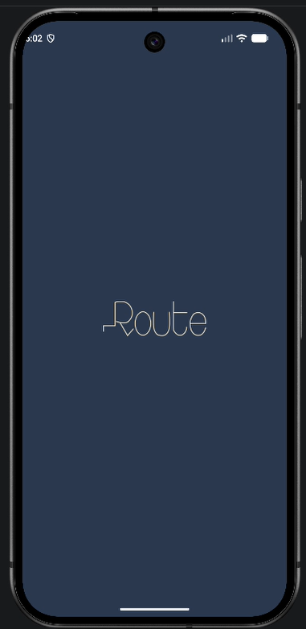
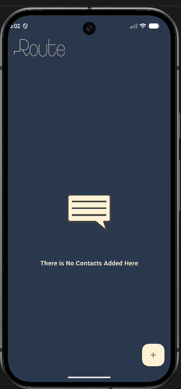
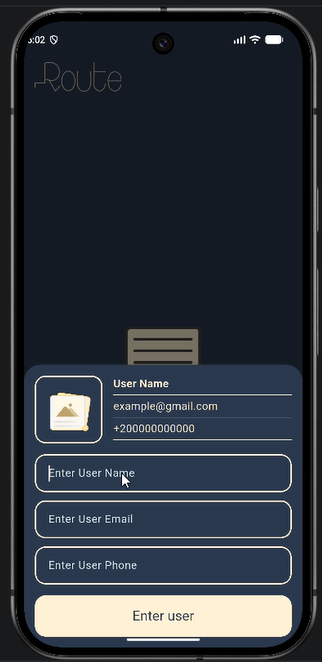
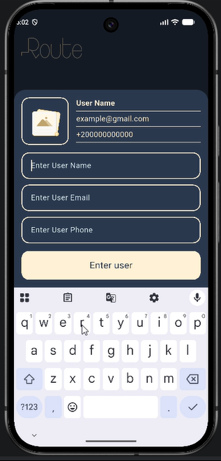
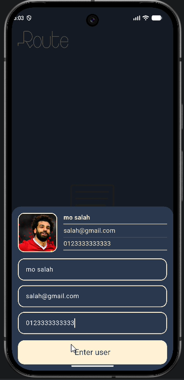
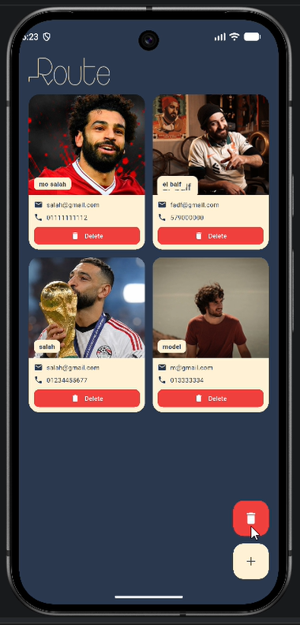
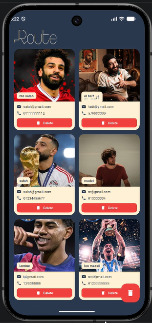

# Contacts App

A Flutter contacts manager built for the **Route Mobile Diploma**. Users can add contacts with a profile photo, browse them in a grid, and delete them.

## Features

- Splash screen with the Route logo
- Empty state with a Lottie animation and a hint message
- Bottom sheet to add a contact, with a **live preview** of the entered data
- Profile photo picked from the gallery using `image_picker`
- Form validation for name, email and phone
- Grid view of contacts with a delete button on each card
- Floating button to delete the last contact (visible only when the list is not empty)
- Add button is hidden once **6 contacts** are added

## Screenshots

| Splash | Welcome | Bottom Nav bar | keyboard open | Data Entered | Home screen | counf full |
|:---:|:---:|:---:|:---:|
|  |  |  |  |  |  | |


## Demo

[Watch the screen recording](testing%20the%20app.mp4)

## Tech Stack

- Flutter & Dart
- [lottie](https://pub.dev/packages/lottie)
- [image_picker](https://pub.dev/packages/image_picker)

## Project Structure

lib/
├── core/ # colors, assets paths, validators
├── models/ # ContactModel
├── screens/ # splash and home screens
└── widgets/ # reusable UI components
assets/
├── images/ # app logo
└── lottie/ # animations


## Getting Started

This repository contains the `lib`, `assets` and `pubspec.yaml` files only. To run it:

```bash
flutter create contact_app
# copy lib/, assets/ and pubspec.yaml into the new project
flutter pub get
flutter run
```

## Author

**Nada Abdelazim** — Route Mobile Diploma
